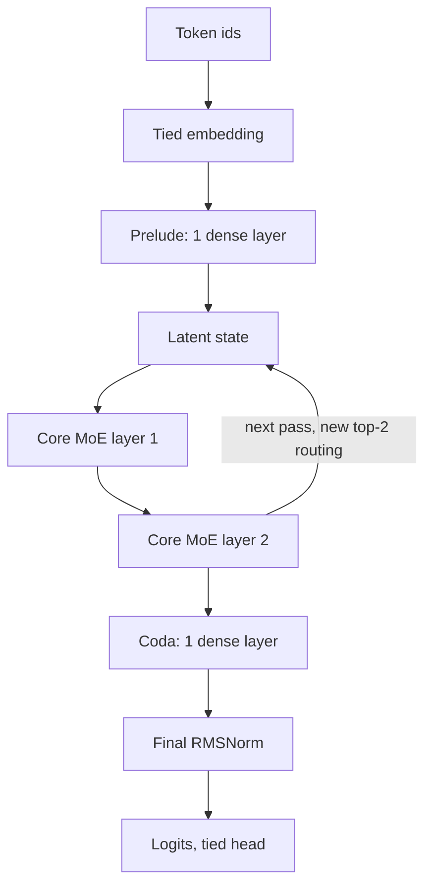

# loopmind-rs

[](https://github.com/liulawrence2002/loopmind-rs/actions/workflows/ci.yml)

LoopMind is a tiny English-first language model trained end to end in Rust. The pipeline follows [MiniMind](https://github.com/jingyaogong/minimind): train a tokenizer, pretrain, supervised-finetune, then chat. The network is a Huginn-style recurrent-depth transformer whose shared core is a fine-grained mixture of experts.

M0 is the workspace, config, parameter census, and CI. M1 is the Burn forward pass, gradient checks, a PyTorch parity test, and a one-layer Burn vs Candle timing check. M2 is the tokenizer, M3 the data pipeline, and M4 the pretrain loop.

The training pipeline is inspired by Jingyao Gong's [MiniMind](https://github.com/jingyaogong/minimind). The recurrence follows Huginn ([Geiping et al., 2025](https://arxiv.org/abs/2502.05171)): a prelude, a core that loops at train time and at inference time, and a coda. The wide, sparse expert layers follow MoEUT (Csordás et al., NeurIPS 2024; [code](https://github.com/RobertCsordas/moeut)). LoopMind uses ordinary grouped-query attention and SwiGLU experts. MoEUT routes attention as well, and its experts are ReLU.

## Architecture



One unique stack is four pre-norm transformer layers:

| Stage | Layers | Feed-forward |
| --- | --- | --- |
| Prelude | 1 | Dense SwiGLU, intermediate 768 |
| Core | 2, shared across the loop | 32 SwiGLU experts of width 128, top-2, routed again every pass |
| Coda | 1 | Dense SwiGLU, intermediate 768 |

Each layer is RMSNorm, attention, residual, RMSNorm, SwiGLU, residual. A final RMSNorm sits in front of the tied output head. Attention is grouped-query: `d_model` 256, 4 query heads, 2 key/value heads, head dim 64, RoPE θ = 1e6, no biases. RMSNorm ε = 1e-6. Vocabulary 6400, context 1024. Embeddings are tied with the output head, so that matrix is stored once.

Dense width 768 is the usual SwiGLU size: two-thirds of `4 * d_model` (682), rounded up to a multiple of 256. The checked-in file is [`configs/default.toml`](configs/default.toml).

Training draws a loop count `r` per sequence from a Poisson with mean 4, clamped to 1..=16, and backpropagates through the last 4 passes only. Earlier passes are detached. The core weights are shared, so `r` does not change the checkpoint size. At inference, `r` is a dial. Each pass adds the prelude state back onto the core output (`s = Core(s) + e`, starting from `s = e`). That residual add has no parameters. There is no learned concat adapter. Sampled training runs one sequence at a time so each row can have its own `r`.

## Parameter count

`cargo run -p loopmind -- params` prints this census. Counts come from the config arithmetic in `loopmind-model` (bias-free linears, SwiGLU = three matrices, router = `d_model * n_experts`, core stored once).

| Component | Params |
| --- | ---: |
| Embeddings, tied with the head | 1,638,400 |
| Attention, 4 layers | 786,432 |
| RMSNorm, 2 per layer plus final | 2,304 |
| Dense SwiGLU, 2 layers × 768 | 1,179,648 |
| Routers, 2 layers × 32 | 16,384 |
| Experts, 2 layers × 32 × width 128 | 6,291,456 |
| **Total** | **9,914,624** |
| Active experts, top-2 | 393,216 |
| **Active per token, excluding embeddings and head** | **2,377,984** |

Active parameters are one pass over the unique layers with only the top-2 experts per core layer. Inactive experts (5,898,240) stay in the checkpoint and out of the active count. Running the core `r` times multiplies FLOPs, not parameters.

The M0 brief quoted ~9,654,016 total and ~2,117,376 active. Those two numbers are internally consistent with this embedding matrix and this MoE (the gap between them is exactly the tied embedding plus the inactive experts). They are not consistent with an integer dense SwiGLU width under the pre-norm block above: hitting them would take a dense intermediate size of about 598. The census uses 768, and both totals are higher by the same 260,608 parameters. The unit test asserts 9,914,624 and 2,377,984.

## Data

English first. The M2 tokenizer is an owned 6400-vocab BPE (`tokenizers` crate).

Pretrain, 50M tokens ([`loopmind-data`](crates/loopmind-data)):

| Slice | Tokens |
| --- | ---: |
| FineWeb-Edu sample-10BT | 25M |
| Cosmopedia-v2 (SmolLM corpus) | 10M |
| TinyStories | 10M |
| English `raw_text_corpus` rows from `KeremTT/FABLE-5.2-MAX-DATABASE` | 5M |

Sequences are 1024 tokens, so this budget packs to 49,997,824 train tokens. The measured build (44.6s pretrain, 82.3s SFT, 153,517 train rows, 2,000 eval rows) is in [docs/data.md](docs/data.md).

SFT uses English chat rows of `KeremTT/FABLE-5.2-MAX-DATABASE`. Rows over 1024 tokens are dropped, Turkish rows are dropped, and 2,000 checkable rows are held out for eval. CC-BY-SA rows stay unless `sft.exclude_cc_by_sa` is set. The builder, shard layout, and the ThinkPad command are in [docs/data.md](docs/data.md). DPO is later and out of scope.

## Crates

| Crate | Role |
| --- | --- |
| `loopmind-model` | Config, parameter census, Burn forward, and the conversion of data batches into tensors. |
| `loopmind-tokenizer` | Byte-level BPE, chat template, and assistant loss mask. |
| `loopmind-data` | Pretrain and SFT shard builder, plus the batch sampler. No Burn dependency. |
| `loopmind-train` | Pretrain and SFT drivers (M4, M5). Depends on the model crate, not on Burn. |
| `loopmind` | `clap` CLI. |

Burn 0.22.1 is the framework. The default build enables the pure-Rust `flex` CPU backend, which is what CI runs. `wgpu` and `cuda` are feature flags on `loopmind` and `loopmind-model`:

```bash
cargo run -p loopmind --features cuda -- params
cargo run -p loopmind --features wgpu -- params
```

M1 compares Burn with Candle. That comparison stays inside `loopmind-model`.

## Commands

```bash
cargo run -p loopmind -- params
cargo run -p loopmind -- params --config configs/default.toml
cargo test --workspace
```

`sft` and `chat` are stubs. Each prints the milestone that will implement it and exits 0. `sft` also prints the data plan. Preparing the shards, then pretraining:

```bash
cargo run -p loopmind --release -- prepare-pretrain --config configs/data.toml
cargo run -p loopmind --release -- prepare-sft --config configs/data.toml
cargo run -p loopmind --release --features cuda -- pretrain --config configs/pretrain.toml --device cuda
cargo run -p loopmind --release -- sample --checkpoint runs/pretrain/checkpoints/step-00000200 --prompt "Once upon a time" --loops 4
```

Train and use the tokenizer:

```bash
python python/fetch_tokenizer_corpus.py
cargo run -p loopmind -- tokenize-train --config configs/tokenizer.toml
cargo run -p loopmind -- tokenize --text "Hello, world."
```

The trained file is `tokenizer/tokenizer.json` (vocab 6400). Raw corpus stays in `data/` and is gitignored. Bytes per token are in [docs/tokenizer.md](docs/tokenizer.md).

PyTorch parity, after the Rust test has written `target/parity`:

```bash
cargo test -p loopmind-model -- --exact model_tests::export_parity_fixture_writes_logits
python python/reference.py target/parity
```

The reference uses Burn's linear layout (`y = x @ W` with `W` shaped `[d_in, d_out]`). The gate is absolute and relative tolerance `1e-5`. On the checked-in tiny config the largest logit gap is about `8e-7`.

One MoE layer, forward and backward:

```bash
cargo run -p moe-bakeoff --release
cargo run -p moe-bakeoff --release --features cuda   # RTX 4070 Laptop, needs the CUDA toolkit
```

## Roadmap

| Milestone | Work |
| --- | --- |
| M0 | Workspace, config, parameter census, CI. Done. |
| M1 | Forward pass, gradient-coverage test, PyTorch parity on a tiny config, and a Burn vs Candle check. Done. See [docs/framework-decision.md](docs/framework-decision.md). |
| M2 | 6400-vocab byte-level BPE, chat template, and loss mask. Done. See [docs/tokenizer.md](docs/tokenizer.md). |
| M3 | Data pipeline for the pretrain mix and the English SFT split. Done. See [docs/data.md](docs/data.md). |
| M4 | Pretrain loop: AdamW, sampled loop counts, truncated backprop, checkpoints. Done. See [docs/pretrain.md](docs/pretrain.md). |
| M5 | SFT and the chat CLI. |

DPO comes after these milestones.

## Hardware

Development target is an NVIDIA GeForce RTX 4070 Laptop with 8 GB. Build that box with `--features cuda`. The model is about 10M parameters with a 1024-token context, which is the size aimed at that card. An f32 pretrain step on that card holds at about 7.4 GB and runs at about 4,100 tok/s, so one epoch is about 3.5 hours. The numbers are in [docs/pretrain.md](docs/pretrain.md).

`wgpu` is the portable GPU feature for machines without CUDA. CI is CPU-only and uses Burn's `flex` backend. The toolchain is stable Rust (`rust-toolchain.toml`); Burn 0.22 sets the minimum at 1.95.

## License

Licensed under either of

- MIT license ([LICENSE-MIT](LICENSE-MIT))
- Apache License, version 2.0 ([LICENSE-APACHE](LICENSE-APACHE))

at your option.
